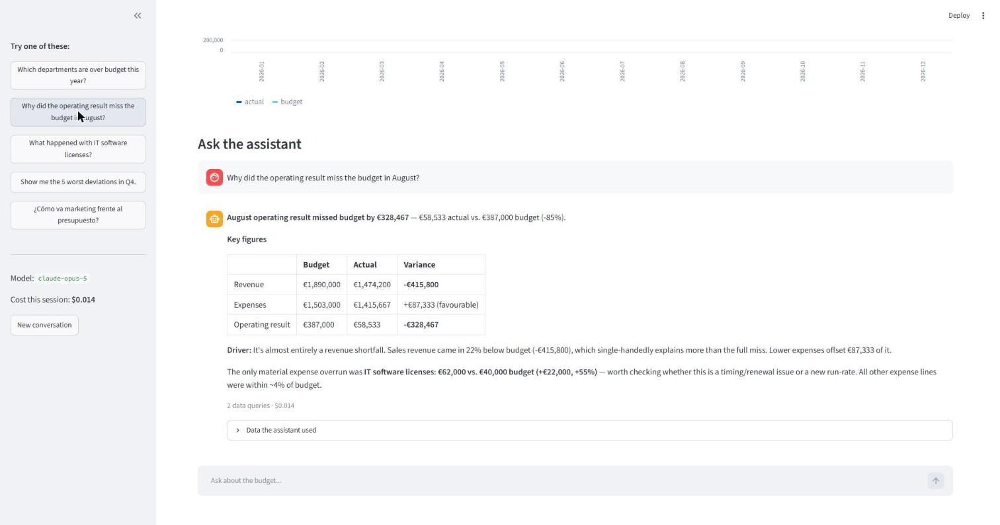

# Finance AI Assistant

Ask questions about **budget vs. actual** in plain language and get exact answers.

> "Why did the operating result miss the budget in August?"
>
> → *Operating result in August was €328k below budget. The main driver is revenue: €416k (-22%) under budget in Sales…*



Built with **Python, pandas and the Claude API**. The company (Northwind Bikes) and all figures are fictitious.

## Why this project

Finance teams spend hours looking for variances in planning reports. I work in Corporate Performance Management (CPM), building planning and budgeting models, and I wanted to see how AI can help with that work **without inventing numbers**.

## How it works

```
Question ──► Claude ──► "I need the P&L for August"  (tool call)
                ▲                     │
                │                     ▼
            answer ◄── result ◄── pandas function runs locally
```

- **pandas does all the maths.** Five analysis functions (P&L summary, variance by any dimension, top deviations, monthly trend, list of dimensions) are given to Claude as *tools*.
- **Claude decides what to look at and explains it.** It never calculates figures itself, so every number comes from the data and can be checked.
- **Transparent:** the app shows which queries the AI made for each answer, and what each question cost.
- **Private by design:** the full dataset never leaves your computer; the model only sees the small tables the tools return.
- **Good variance logic:** each variance is marked as favourable or unfavourable (more income is good, more expense is bad).

## Project structure

```
data/generate_data.py          creates the fictitious dataset (with a few planted deviations)
finance_assistant/analysis.py  budget-vs-actual analysis with pandas
finance_assistant/assistant.py the tool-use loop with the Claude API
app.py                         web app (Streamlit): dashboard + chat
cli.py                         terminal version
tests/                         tests for the analysis and the AI loop (no API key needed)
```

## Run it

```bash
pip install -r requirements.txt
python data/generate_data.py        # creates data/budget_vs_actual.csv
copy .env.example .env              # then add your Anthropic API key in .env
streamlit run app.py                # web app
python cli.py "Which departments are over budget?"   # or the terminal
pytest                              # tests
```

You need an API key from the [Anthropic Console](https://console.anthropic.com/). The `.env` file is in `.gitignore`, so the key is never uploaded.

## Cost

Each question uses a few tool calls. The app shows the cost of every answer. You can switch to a cheaper model in `.env`:

```
FINANCE_ASSISTANT_MODEL=claude-sonnet-5
```

## Ideas for next steps

- Load real exports (Excel/CSV) from a planning tool instead of the fictitious data.
- Add forecasting (e.g. full-year landing based on year-to-date actuals).
- Generate a monthly variance commentary automatically for the management report.

---

Made by [Ivan Mur Ordóñez](https://www.linkedin.com/in/ivanmurordonez) · Data & Analytics Consultant
